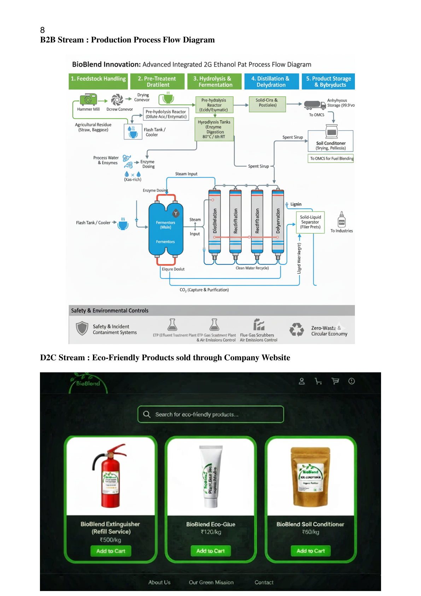

# BioBlend — Integrated 2G Ethanol Biorefinery Concept

> **“We create fuel, that doesn’t cost the Earth.”**

BioBlend is an academic innovation and entrepreneurship project proposing an integrated second-generation (2G) ethanol biorefinery that valorises agricultural residues and explores multiple commercial product streams. The concept combines fuel production with biomass-derived co-products, customer validation, business-model design and a five-year financial projection.

**Project context:** Innovation & Entrepreneurship (UTA025), Venture Lab, Thapar Institute of Engineering & Technology, Patiala  
**Project group:** 3D11_5  
**Academic session:** July–December 2025

## Project at a glance

The proposed facility uses non-food agricultural biomass as feedstock and considers four product streams:

| Product stream | Intended market/application in the project |
|---|---|
| 2G anhydrous ethanol | Fuel blending and industrial customers |
| Organic soil conditioner | Agricultural and household gardening markets |
| Lignin-based bio-adhesives | Industrial and household adhesive applications |
| Captured and purified CO₂ | Industrial uses and proposed household fire-safety products |

The project explores a circular biorefinery concept: converting agricultural residues into fuel and value-added products rather than treating the biomass solely as waste.

## Conceptual process

The report's process-flow illustration covers feedstock handling, pretreatment, hydrolysis and fermentation, distillation/dehydration, product storage, and routes for handling biomass-derived streams.



*Source: project report, process-flow and D2C concept page. This is a conceptual academic proposal, not evidence of a constructed or commissioned plant.*

## Project work

The team developed the following components:

1. **Opportunity analysis** — agricultural residue management, 2G ethanol opportunity, target users and customers, value proposition and adoption strategy.
2. **Process conceptualisation** — a high-level integrated biorefinery flow and proposed co-product pathways.
3. **Customer discovery and validation** — separate B2B industrial ethanol and D2C household-products surveys.
4. **Business-model development** — Opportunity Canvas and Business Model Canvas.
5. **Financial feasibility exercise** — proposed capital structure, CAPEX/OPEX, revenue assumptions, five-year P&L and cash-flow projections.
6. **Brand and product positioning** — BioBlend identity, product portfolio and proposed D2C storefront concept.

## Customer validation

Two survey workbooks were supplied with the project materials. The original workbooks contain direct identifiers and have **not** been included in this public-ready package. No row-level response files are included. Only aggregate findings reported in the submitted project report are retained.

| Survey | Audience | Rows in supplied response workbook |
|---|---|---:|
| B2B ethanol survey | Industrial/business respondents | 52 |
| D2C household-products survey | Household consumers | 183 |
| **Total** | | **235** |

The counts above are the non-empty response rows in the supplied workbooks and match the totals stated in the submitted report. Question-level valid-response counts vary because not every question necessarily has the same number of answers.

### Selected findings reported in the project report

The report's own analysis highlights:
- 84.6% of B2B respondents selected ethanol purity/grade specifications as an important supplier-selection factor.
- 69.2% selected price per litre.
- 80.8% rated sustainability as very or somewhat important in procurement.
- 72.7% of D2C respondents preferred natural soil-enrichment options.
- 88% expressed very or somewhat high interest in the proposed organic soil conditioner.
- 94.6% expressed interest in a plant-based adhesive, assuming comparable bonding strength.
- 95% expressed very or somewhat high interest in the proposed household fire extinguisher.

These percentages are reproduced as reported in the academic report; question denominators vary and should be consulted before interpreting them as percentages of the full workbook row counts.

## Proposed financial model

The report models a conceptual project with:

| Item | Reported assumption |
|---|---:|
| Total project cost | ₹150 crore |
| Fixed-asset CAPEX | ₹120 crore |
| Pre-operative and other setup costs | ₹30 crore |
| Equity | ₹45 crore (30%) |
| Debt | ₹105 crore (70%) |
| Plant utilisation | 45% in Year 1, rising to 95% in Year 4 and Year 5 |

The report includes a five-year cost structure, revenue structure, Profit & Loss statement and cash-flow statement. These are **academic projections based on project assumptions**, not audited results, investor guidance or verified commercial forecasts.

### Financial-model caveats

The supplied report and canvas contain differences that should remain visible to readers:
- The canvas describes byproduct revenue as 6.90% of total revenue, while the detailed report's revenue breakdown lists approximately ₹71 lakh of byproduct revenue against ₹101.27 crore total Year 1 revenue (roughly 0.7%).
- Some canvas and report figures for costs and revenue differ.
- The canvas mentions a four-year breakeven period; the underlying cash-flow assumptions should be reconciled before treating that as a definitive result.

The repository therefore preserves the original submitted documents and flags these discrepancies rather than silently rewriting the team's calculations.

## Repository contents

```text
BioBlend/
├── README.md
├── docs/
│   ├── BioBlend_Project_Report_Public_Edition.pdf
│   └── BioBlend_Canvases.pdf
├── assets/
│   └── bioblend_poster_preview.png
├── presentation/
│   └── BioBlend_Project_Poster.pdf
├── process/
│   └── biorefinery_process_and_product_concept.png
├── research/
│   ├── Customer_Validation_Results.md
│   ├── B2B_Survey/
│   │   └── README.md
│   └── D2C_Survey/
│       └── anonymized_responses.csv
└── financial_model/
    └── README.md
```

## Team

- Rachit Saini
- Debojeet Dutta
- Pranvat Singh
- Gursewak Singh
- Aashray Sharma
- Meitreya Priyadarshi

**Course instructor:** Dr. Parag Nijhawan  
**Institution:** Thapar Institute of Engineering & Technology, Patiala

## Scope and disclaimer

BioBlend was developed as a course project for Innovation & Entrepreneurship (UTA025). It is a conceptual business and feasibility study. The repository does not claim that the proposed plant was built, that the process was experimentally validated by the team, or that the financial projections represent actual operating performance. Technical process details, regulatory requirements, product certifications, market prices and financial assumptions would require independent validation before implementation.

## Data privacy and reuse

No respondent-level survey data, raw exports, identifying information or free-text submissions are included. Only aggregate findings are published. The original workbooks are intentionally omitted.

The project report, poster and canvases are collaborative academic work. Confirm that all team members agree to public distribution before making this repository public. No open-source licence is applied to the team-authored materials by default; obtain permission from the relevant contributors before reuse.


## Survey privacy

This public edition excludes the survey questionnaire pages and respondent-level/free-text response pages from the original report. The separate research summary contains aggregate findings only. Original response workbooks are not part of this repository.
